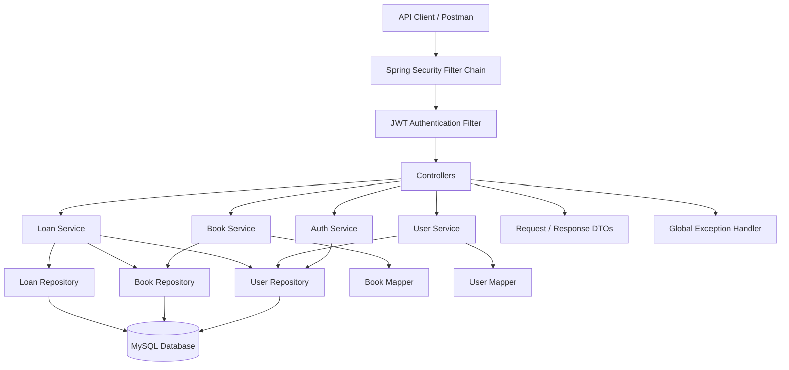

# 📚 Library Management System

A RESTful Library Management System built with **Java, Spring Boot, Spring Security, JWT Authentication, Spring Data JPA, and MySQL**. The project demonstrates layered backend architecture, role-based access control, book inventory management, and a borrowing and returning workflow.

🔗 **GitHub Repository:** [library-management-system](https://github.com/thanmay0718/library-management-system)

---

## 📌 Table of Contents

- [Overview](#-overview)
- [Features](#-features)
- [Technology Stack](#-technology-stack)
- [Architecture](#-architecture)
- [Project Structure](#-project-structure)
- [Database Model](#-database-model)
- [API Endpoints](#-api-endpoints)
- [Getting Started](#-getting-started)
- [Authentication and Authorization](#-authentication-and-authorization)
- [Error Handling and Validation](#-error-handling-and-validation)
- [Future Enhancements](#-future-enhancements)
- [Author](#-author)

---

## 🎯 Overview

The Library Management System is a backend application designed to manage books, users, and library borrowing transactions through REST APIs.

It follows a layered architecture that separates controllers, services, repositories, entities, DTOs, and security components. This separation improves maintainability, testing, and scalability.

The application uses JWT-based authentication to protect endpoints and role-based authorization to control access to administrative operations.

## ✨ Features

### 🔐 Authentication and Security

- User registration and login APIs.
- JWT-based authentication.
- Password hashing using BCrypt.
- Custom user authentication through Spring Security.
- Stateless session management.
- Role-based authorization using `USER` and `ADMIN` roles.
- JWT authentication filter integrated into the Spring Security filter chain.

### 📚 Book Management

- Create, retrieve, update, and delete book records.
- Manage book details such as title, author, ISBN, category, and copy counts.
- Track total and available copies.
- Use request and response DTOs to control API payloads.
- Validate incoming book data.

### 🔄 Loan Management

- Borrow books through a REST API.
- Return borrowed books.
- Renew active loans.
- View the authenticated user's loan history.
- Retrieve overdue loans through an admin-restricted endpoint.
- Track borrow dates, due dates, return dates, and loan status.
- Check book availability when borrowing.
- Use database locking when retrieving books for borrowing to help prevent concurrent inventory updates from conflicting.

### 👤 User Management

- Register users and manage user information.
- Store user roles.
- Retrieve user records through the service and repository layers.
- Use DTOs and mappers to separate API data from entity objects.

### ⚙️ Backend Engineering

- Layered architecture with controllers, services, and repositories.
- Spring Data JPA for database access.
- ModelMapper configuration.
- Centralized exception handling.
- Custom resource-not-found exception.
- Request validation and structured API responses.

---

## 🛠️ Technology Stack

| Technology | Purpose |
|---|---|
| Java | Backend programming language |
| Spring Boot | Application framework |
| Spring Web | REST API development |
| Spring Security | Authentication and authorization |
| JWT | Token-based authentication |
| Spring Data JPA | Persistence and repository abstraction |
| Hibernate | ORM implementation |
| MySQL | Relational database |
| Maven | Dependency and build management |
| Jakarta Validation | Request validation |
| ModelMapper | Object mapping |
| BCrypt | Password hashing |
| Postman | API testing |

---

## 🏗️ Architecture

The application follows a layered architecture.



### Architecture Layers

- **Controller:** Exposes REST endpoints and handles HTTP requests.
- **Service:** Contains business logic for authentication, books, users, and loans.
- **Repository:** Provides database operations through Spring Data JPA.
- **Entity:** Represents persistent domain objects.
- **DTO:** Defines request and response payloads.
- **Mapper:** Converts between entities and DTOs.
- **Security:** Handles JWT validation, authentication, and access control.
- **Exception handling:** Provides centralized handling for application errors.

---

## 📁 Project Structure

```text
library-management-system/
├── backend/
│   ├── src/
│   │   └── main/
│   │       ├── java/
│   │       │   └── com/library/management/
│   │       │       ├── ManagementApplication.java
│   │       │       │
│   │       │       ├── config/
│   │       │       │   ├── ModelMapperConfig.java
│   │       │       │   ├── PasswordEncoderConfig.java
│   │       │       │   ├── SecurityBeansConfig.java
│   │       │       │   └── SecurityConfig.java
│   │       │       │
│   │       │       ├── controller/
│   │       │       │   ├── AuthController.java
│   │       │       │   ├── BookController.java
│   │       │       │   ├── LoanController.java
│   │       │       │   └── UserController.java
│   │       │       │
│   │       │       ├── entity/
│   │       │       │   ├── Book.java
│   │       │       │   ├── Loan.java
│   │       │       │   ├── LoanStatus.java
│   │       │       │   ├── Role.java
│   │       │       │   └── User.java
│   │       │       │
│   │       │       ├── exception/
│   │       │       │   ├── GlobalExceptionHandler.java
│   │       │       │   └── ResourceNotFoundException.java
│   │       │       │
│   │       │       ├── mapper/
│   │       │       │   ├── BookMapper.java
│   │       │       │   └── UserMapper.java
│   │       │       │
│   │       │       ├── payload/
│   │       │       │   ├── AuthResponseDTO.java
│   │       │       │   ├── BookRequestDTO.java
│   │       │       │   ├── BookResponseDTO.java
│   │       │       │   ├── LoanRequestDTO.java
│   │       │       │   ├── LoanResponseDTO.java
│   │       │       │   ├── LoginRequestDTO.java
│   │       │       │   ├── UserRequestDTO.java
│   │       │       │   └── UserResponseDTO.java
│   │       │       │
│   │       │       ├── repository/
│   │       │       │   ├── BookRepository.java
│   │       │       │   ├── LoanRepository.java
│   │       │       │   └── UserRepository.java
│   │       │       │
│   │       │       ├── security/
│   │       │       │   ├── CustomUserDetailsService.java
│   │       │       │   ├── JwtAuthenticationFilter.java
│   │       │       │   └── JwtService.java
│   │       │       │
│   │       │       └── service/
│   │       │           ├── AuthService.java
│   │       │           ├── BookService.java
│   │       │           ├── LoanService.java
│   │       │           ├── UserService.java
│   │       │           └── ServiceImpl/
│   │       │               ├── BookServiceImpl.java
│   │       │               ├── LoanServiceImpl.java
│   │       │               └── UserServiceImpl.java
│   │       │
│   │       └── resources/
│   │           └── application.properties
│   │
│   ├── pom.xml
│   └── mvnw.cmd
│
├── docs/
│   └── images/
│
└── README.md
```

*The tree documents the Java source files you currently have. The resources and Maven entries show the expected locations; confirm them against your repository if their names or locations have changed.*

---

## 🗄️ Database Model

The application uses relational entities connected through JPA relationships.

### Book

Represents the library's book inventory.

Typical attributes include:

- `id`
- `title`
- `author`
- `isbn`
- `category`
- `totalCopies`
- `availableCopies`

### User

Represents a registered application user.

Includes identity and login information, a hashed password, and a role used for authorization.

### Loan

Represents a book borrowing transaction.

Includes:

- The associated user and book.
- Borrow date and due date.
- Return date, when returned.
- Loan status.

### Enumerations

- `Role`: defines the application's user roles, including `USER` and `ADMIN`.
- `LoanStatus`: tracks loan states such as `BORROWED`, `RETURNED`, and `OVERDUE`.

### Relationships

- One user can have multiple loan records.
- One book can appear in multiple loan records over time.
- Each loan refers to one user and one book.

---

## 🔌 API Endpoints

The following loan endpoints are implemented in the current application.

| Method | Endpoint | Access | Description |
|---|---|---|---|
| POST | `/api/loans/borrow` | Authenticated | Borrow a book |
| PUT | `/api/loans/{loanId}/return` | Loan owner | Return a borrowed book |
| PUT | `/api/loans/{loanId}/renew` | Loan owner | Renew an eligible loan |
| GET | `/api/loans/my-loans` | Authenticated | View the current user's loans |
| GET | `/api/loans/overdue` | Admin | Retrieve overdue loans |

### Authentication APIs

Authentication endpoints are exposed through `AuthController.java`. User registration is also exposed through `UserController.java`.

- Authentication routes use the `/api/auth/**` namespace.
- User registration is permitted through `POST /api/users/register`.

Check the controller annotations for the exact login and registration paths and request formats.

### Book APIs

`BookController.java` exposes book-management operations. Refer to its `@RequestMapping` and method-level `@GetMapping`, `@PostMapping`, `@PutMapping`, and `@DeleteMapping` annotations for the exact paths.

### Example: Borrow a Book

**Request**

```http
POST /api/loans/borrow
Authorization: Bearer YOUR_JWT_TOKEN
Content-Type: application/json
```

```json
{
  "bookId": 302
}
```

The request uses the authenticated user's identity and the requested book ID. The server checks eligibility and availability before creating a loan.

### Example: View My Loans

```http
GET /api/loans/my-loans
Authorization: Bearer YOUR_JWT_TOKEN
```

The response includes loan details such as the loan ID, book ID, book title, borrow date, due date, return date, and status.

> Exact response fields and error formats depend on the current DTO and exception-handler implementations.

---

## 🚀 Getting Started

### Prerequisites

Install the following:

- JDK 17 or a compatible version required by your Maven configuration.
- MySQL Server.
- Git.
- An IDE such as IntelliJ IDEA or VS Code.
- Postman for API testing.

### 1. Clone the Repository

```bash
git clone https://github.com/thanmay0718/library-management-system.git
cd library-management-system
```

### 2. Configure the Database

Create a MySQL database for the application.

```sql
CREATE DATABASE library_management;
```

Configure the database connection in `backend/src/main/resources/application.properties`.

Example configuration:

```properties
spring.datasource.url=jdbc:mysql://localhost:3306/library_management
spring.datasource.username=${DB_USERNAME}
spring.datasource.password=${DB_PASSWORD}

spring.jpa.hibernate.ddl-auto=update
```

Ensure the application includes the required MySQL driver and JPA dependencies in `pom.xml`. Adjust the configuration to match your existing project.

**Security note:** Do not commit database passwords, JWT signing secrets, or other credentials to GitHub. Use environment variables or a local configuration file excluded from version control.

### 3. Run the Backend

On Windows, open PowerShell in the repository root and run:

```powershell
cd backend
.\mvnw.cmd spring-boot:run
```

If the Maven wrapper is unavailable, use an installed Maven distribution:

```bash
mvn spring-boot:run
```

The application commonly runs at:

```text
http://localhost:8080
```

Use the port configured in `application.properties` if it differs.

### 4. Test with Postman

1. Register a user using the registration endpoint.
2. Log in using the configured authentication endpoint.
3. Copy the JWT token from the authentication response.
4. Send the token in the `Authorization` header:

```http
Authorization: Bearer YOUR_JWT_TOKEN
```

5. Test book operations according to your user's role.
6. Borrow an available book.
7. Retrieve your loans, then test returning and renewing an eligible loan.

---

## 🔒 Authentication and Authorization

The backend uses Spring Security with JWT authentication.

The authentication flow is:

1. The client submits login credentials.
2. The application authenticates the user.
3. The server issues a JWT.
4. The client sends the token with subsequent protected requests.
5. `JwtAuthenticationFilter` validates the token and establishes the security context.
6. Spring Security checks authorization rules before allowing access.

### Security Components

| Component | Responsibility |
|---|---|
| `SecurityConfig.java` | Configures endpoint access and the security filter chain |
| `JwtService.java` | Handles JWT-related operations |
| `JwtAuthenticationFilter.java` | Processes incoming JWTs |
| `CustomUserDetailsService.java` | Loads user details for authentication |
| `PasswordEncoderConfig.java` | Configures password hashing |
| `Role.java` | Defines application roles |

The application uses stateless session management, meaning the server does not rely on an HTTP session to retain the user's authentication between requests.

Administrative operations, including the overdue-loans endpoint, are restricted by authorization rules.

---

## 🛡️ Error Handling and Validation

The project includes centralized exception handling and a custom resource-not-found exception.

- `GlobalExceptionHandler.java` handles application exceptions centrally.
- `ResourceNotFoundException.java` represents missing resources.
- Request DTOs can enforce validation rules.
- Service-layer checks enforce business rules, such as loan ownership and loan eligibility.

These mechanisms help return meaningful errors and keep validation logic separate from controller code.

---

## 🔮 Future Enhancements

Potential improvements for future iterations include:

- Automatic fine calculation for overdue books.
- Pagination, sorting, and advanced book search.
- Loan limits and borrowing eligibility policies.
- Admin dashboard and library statistics.
- Automated overdue notifications.
- Unit and integration testing.
- API documentation with Swagger / OpenAPI.
- Docker-based deployment.
- CI/CD integration.
- Production database migration management.

These are planned enhancements, not claims that the features are already implemented.

---

## 👨‍💻 Author

**Thanmay**

- GitHub: [@thanmay0718](https://github.com/thanmay0718)
- Project: [Library Management System](https://github.com/thanmay0718/library-management-system)

---

## 📄 License

Add a license file to the repository if you intend to distribute this project under an open-source license.

---

*Built as a backend engineering project to practice Java, Spring Boot, REST API development, relational database design, and secure application architecture.*
